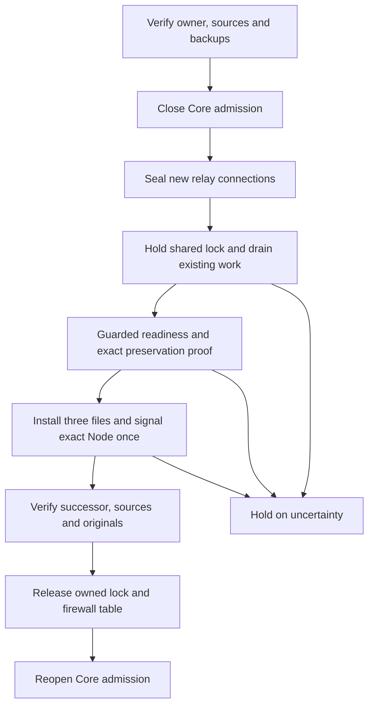

# Restored-target diagnostic and graceful relay activation

This is a source-only, three-file relay package plus a separately bound operator.
The runtime package adds the reviewed original-target diagnostic and closes the
relay shutdown race. It does not recover an original provider job, send a prompt,
rewrite a selector, or activate a project. Core, Chrome, QA, SSH, Xvfb, egress and
the watchdog remain outside the restart scope.

**Runtime identity:** `runtime/manifest.json` SHA-256
`d6001e29d6b3ef1b5b6c3ba544e92526080e6745b1d0e4279c11eab0d293adc1`.
It pins three postimages, two existing preimages, the new probe's absence, both
patches, and 23 unchanged source/launcher/unit dependencies. The earlier
`26a374594f9d6f7b477d5f440fc36ae1b41a4390` diagnostic package is preserved.

| Runtime path | Existing SHA-256 prefix | Candidate SHA-256 prefix |
| --- | --- | --- |
| `aibit_relay.cjs` | `5bf18e2aac4a` | `06dd2e383c67` |
| `original_dot_target_probe.cjs` | Absent | `b0c08836cbc1` |
| `erp_task_relay.cjs` | `0355af93e5ae` | `b28c6137be42` |

## Runtime change

A shutdown signal synchronously closes intake and prevents a delayed reservation
from starting another browser turn. The relay waits for the listener closure,
actual HTTP handler promises, reserved browser turns, and detached ERP turns and
inspections before exiting. A disconnected client no longer makes its continuing
provider work invisible to shutdown. Existing admitted work is not cancelled.
The ERP deadline observer stops admitting new inspections and finishes inspections
already admitted. It does not relabel uncertain history.

`GET /runtime-status` is a loopback infrastructure endpoint, with the same
unauthenticated reachability class as existing health. It exposes only a fixed
protocol identifier, process ID, booleans and four nonnegative work counts. It does
not call the browser or return account, target, conversation, token or message
data. Existing business authentication and scope checks remain in
`handleRelayRequest`. The generated FastAPI API & Developers catalogue stays
dynamic and unchanged; no operation exclusion or hard-coded catalogue entry was
introduced. `docs/api-module.md` documents this boundary.

The restored-target diagnostic remains explicitly requested through authenticated
`POST /dot/observe`, using `diagnostic_mode: "restored_target"`. It searches only
already-open exact landing targets and revalidates the original full envelope,
account, sealed root and Core receipt. A match does not install a new selector or
authorize replay. The probe implementation is byte-identical to the accepted
diagnostic package.

## Why the first upgrade needs a separate barrier

The old running relay cannot use a shutdown correction that is only on disk.
Its `server.close(() => process.exit(0))` can exit after the caller disconnects,
while an asynchronous provider handler remains. Core maintenance does not cover
all ordinary relay producers, and scoped sends bypass the shared browser lock.

The bootstrap therefore seals only new nonroot TCP SYN connections to
`127.0.0.1:8810`. Existing connections are never reset or closed. It waits for
**every usable existing relay connection** to disappear naturally, including
keepalive and half-closed connections. Root's fixed, bounded probe is the explicit
trusted administrator exception; it closes its connection before the cutover.
Persistent connections cause a hold.

The exact running watchdog was reviewed: it checks process identity and occupied
ports, not HTTP health. Rejecting new relay connections cannot cause the watchdog
to restart an existing Node. The SSH process, its established transport and its
forwarding configuration are preserved.

The only firewall mutation is creation/deletion of
`ip abit_relay_bootstrap_20261122`, containing one output chain and one narrow
nonroot-SYN rejection rule. Complete existing rule configuration and the owned
table's exact content and handles are bound. No flush, unrelated rule edit,
general acceptance rule, or host-network test is used. A command whose
acknowledgement is lost is observed without being repeated.

## Operator flow

The Python operator uses the reviewed global release lock, current operator
session, current Core maintenance CAS/audit contract, immutable command intents,
exact process birth and command hashes, and one pidfd SIGTERM. It never starts
Node itself or restarts a unit. The unchanged watchdog owns the successor.

The shared-lock keeper executes the existing pinned application lock
implementation from its verified bytes. Its own reviewed script is copied to the
root-only stage before execution with a clean environment. It retains the lock if
the operator disconnects. Only an exact protected release receipt, tied to the
held receipt and original process, releases it. A failed or unknown keeper
acquisition is not duplicated. Release never removes another lock owner.

Detached Hermes work has an additional finite barrier: the actual Node's
nonsensitive runtime paths, local Hermes origin and configured timeout are
validated. After ingress drains, the helper requires a continuous period without
Node-owned TCP work longer than the existing headers timeout. A continuing
response body retains a socket and causes a hold. The subsequent readiness
round-trip is performed while the same firewall seal and shared lock remain.
The probe's own CDP/HTTP sockets must also close before the signal.

### The narrowly permitted health side effect

The old `/health` is **not universally read-only**. A missing dedicated target can
cause allocation, so the helper first proves the exact dedicated target already
exists in a read-only CDP inventory, and checks the inventory and authoritative
state again afterward.

An expired in-memory relink can clear the **rebuildable Project catalogue cache**
at `state/aibit-relay-projects.json`. Root explicitly authorized this one
maintenance side effect. The exact cache preimage is protected before the probe.
An accepted change must contain exactly `updated_at` and an empty `projects`
array, with its timestamp inside the bounded probe. The sanitized before/after
proof records whether expiry happened. It does not restore an expired in-memory
relink or imply that user projects were deleted.

All authoritative original binding files, dedicated target and thread selectors,
configuration, rate-limit state, terminal legacy ERP journals, development-run
state, historical relay/Dot rows, and original governance invocation/start/result
rows remain exact. No dead PID is treated as evidence that an uncertain job
completed. Nonterminal legacy ERP journals, changed original rows, missing
targets, an active provider turn, or a changed preserved process cause a hold.

## Binding and root execution path

The operator source is deliberately `MANIFEST_SHA = 'UNBOUND'`. It cannot apply
until root reviews the independent evidence and binds fresh inputs. No live
firewall, browser, service, provider, or business-ledger action has been performed
by this package's source work.

1. Verify the committed source and `operator-source-freeze.json` in the evidence
   directory. Review the complete four operator components and the three runtime
   deltas. Do not install the old two-file diagnostic manifest by itself.
2. Run the reviewed `capture_inputs.py` through the existing root administration
   route to obtain **draft** metadata and aggregate hashes. It performs read-only
   source/process/unit, SQLite, CDP-inventory and firewall observations. It never
   calls `/health`, changes a gate or rule, or sets activation authorization.
   It has not been executed as part of source validation.
3. Preserve or refresh the 11 verified online backups and restore receipts.
   The helper permits the already verified root backup stage
   `/var/lib/abit-ai-orchestration-recovery-20261122T1015`, or a fresh equivalent
   under `/var/lib/abit-ai-restored-target-activation-20261122/backup`.
   The chosen exact receipt and backup hashes must verify.
4. Create the root-only stage
   `/var/lib/abit-ai-restored-target-activation-20261122` and its `inputs`
   subdirectory as root:root 0700. Review the draft, retain the current authorized
   operator owner, and set `live_activation_authorized` true only after the gate
   checks are accepted. Save the exact JSON as root:root 0600
   `activation-manifest.json` in this operator source directory; it is Git-ignored.
   The manifest includes the unbound release script hash and exact helper hashes.
5. Replace **only the complete assignment line**
   `MANIFEST_SHA = 'UNBOUND'` in a copy of `release_relay.py` with the reviewed
   manifest's SHA-256. Preserve the original source. Install the bound copy as
   root-owned read-only code in the protected stage, for example
   `release_relay.bound.py`. Record its hash. The helper normalizes this single
   binding and checks its complete unbound source identity against the manifest.
6. Use the fixed existing administrative route, from ABIT-DEV-LINUX:
   `sudo -n -- /usr/bin/python3 -I -S -B /var/lib/abit-ai-restored-target-activation-20261122/release_relay.bound.py preflight`.
   The same fixed script accepts only `apply`, `finalize`, or `rollback`.
   Root owns those live actions. Do not run a second helper concurrently.

`preflight` is read-only and does not call browser health. `apply` carries out
the bound sequence. `finalize` observes previously issued actions and may update
only the operator's proof journal; it does not issue a firewall command, gate
command, signal, source write, or keeper release. Continue the original `apply`
or `rollback` only when a definite unfinished step is known.

Rollback restores only known packaged preimages and removes only the exact added
probe. Before a signal, it can restore source without restarting the untouched
original Node. An unresolved original signal cannot trigger another transition.
If the original ceased and no replacement exists, rollback restores bytes for the
unchanged watchdog and binds the first verified successor; it never launches
Node or signals an unobserved process. A changed successor is rejected even on
late finalization. Uncertainty leaves admission held, with the exact operator
journal and existing provider work preserved.

## Verification and limits

The evidence directory is
`docs/evidence/2026-11-22-restored-target-activation`.

- 28 distinct operator cases: a 25-case baseline, two added successor cases and
  one added rollback case. The changed rollback group passed four cases on the
  final source. Coverage includes a real disposable child/pidfd lost-acknowledgement
  test and preserves every earlier receipt.
- 12 relay lifecycle cases use actual source functions and real disposable
  loopback HTTP connections, including disconnected scoped work, aborted request
  bodies, streaming failures and actual ERP inspection maps.
- Three actual shared-lock cases cover retained unknown state, interrupted
  acquisition and another owner's replacement lock.
- 26 original-diagnostic composition cases retain the original assertions. The
  fixture selects the now-named actual handler while preserving the old callback
  fallback.
- Five kernel assertion groups execute in a fresh network namespace proven
  different from the caller's namespace. They preserve an established nonroot
  stream, deny a new nonroot connection, permit the bounded root probe, preserve
  an unrelated table and remove only the owned table. Host firewall unchanged.
- Both three-file patches reconstruct with `--fuzz=0`; all postimages and restored
  preimages, including new-file absence, match.
- API verification passed 18 contract, 48 backend/developer and 37 frontend tests,
  with Svelte 0 errors/0 warnings and 1,300 pinned source inputs unchanged.
  The isolated integration gate passed 104 checks with zero failures and 615
  registered HTTP operations. All 1,300 input hashes remained unchanged.

Early private-netns runs exposed an overly strict *test expectation* that nft
would render symbolic TCP flags numerically. The actual nft 1.0.9 representation
was captured, the exact expected representation corrected, and the final
frozen barrier passed. No live rule was involved. All early receipts are retained.

The tests do not prove a live provider response, account login, original-target
recovery, or deployment. Private authority/browser data are controlled fixtures
where required. Root-only production binding, actual preserved data, operator
lease and live replacement behavior remain operator preflight/acceptance gates.
