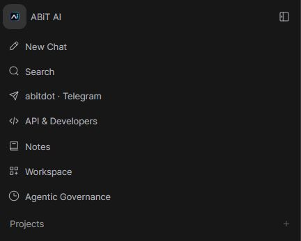

# ABIT.AI API module

The application exposes **API & Developers** at **/developers**. It provides a
searchable reference of registered HTTP operations, request and response schemas,
authentication requirements, request examples, API-key management, and OpenAPI and
Postman downloads.

## Documentation endpoints

All documentation endpoints require an existing verified application account.

| Method | Path | Result |
| --- | --- | --- |
| GET | /api/v1/developer/ | Current-account API policy, operation counts, groups and realtime coverage |
| GET | /api/v1/developer/openapi.json | OpenAPI schema generated from the running application's registered routes |
| GET | /api/v1/developer/postman.json | Postman v2.1 request templates for the same visible operations |

The reference includes core and custom ABiT HTTP routes: chats, project folders,
agents and automations, knowledge, files, tools, models, providers, account
settings, collaboration, calendars, integrations, administration and the
documentation module itself. Conditional features appear only when their routes
are registered.

OpenAPI generation uses the existing route definitions and Pydantic schemas. It
does not create a parallel implementation of application features. Generic
provider proxy bodies remain provider-specific. Unknown dictionary fields are not
presented as a complete typed contract.

### Authentication and authorization

Use an account's personal key in the Authorization bearer header when API keys
are enabled. A valid application session bearer token follows the existing
authentication implementation.

The module reads existing configuration and permissions:

- auth.enable_api_keys
- auth.api_key.endpoint_restrictions
- auth.api_key.allowed_endpoints
- user.permissions and the features.api_keys permission

It does not enable API keys, broaden endpoint restrictions, modify roles or grant
access to resources. Existing ownership, group, feature and administrator checks
continue to run in the original endpoints.

The existing API-key endpoints remain GET, POST and DELETE at
/api/v1/auths/api_key. Creating a new key replaces the account's existing key.
Revoking a key invalidates subsequent key-authenticated requests.

Administrator operations are omitted from a regular user's exported schema.
Dependency traversal recognizes nested administrator checks. The reference also
handles inline administrator restrictions in ChatGPT relay, code handoff,
knowledge reindex and Telegram bot configuration. Documentation filtering is not
an authorization boundary.

Each operation includes:

| Extension | Meaning |
| --- | --- |
| x-abit-access | public, authenticated, admin or custom authentication |
| x-abit-auth-note | Endpoint-specific authentication and authorization guidance |
| x-abit-api-key-access | allowed, restricted, conditional, disabled, not-required or custom |

A conditional key result means that a configured concrete resource path may
match only some values of an operation's path parameters. A documented operation
may still be unavailable because of its feature flag or resource permissions.

Project instructions are stored in the folder data.system_prompt field. Create
projects with POST /api/v1/folders/ and update their supported settings with
POST /api/v1/folders/{id}/update. Existing synchronized-project locks and folder
sharing rules continue to apply.

### Special protocols

SCIM requires its separate provisioning bearer token. Telegram MCP requires its
scoped OAuth token and protocol request format. Telegram bot webhook delivery
uses the configured X-Telegram-Bot-Api-Secret-Token header. Browser OAuth steps
require their existing protocol state and credentials.

Socket.IO under /ws and registered terminal WebSocket routes are reported
separately. They are not represented as REST operations. Terminal WebSockets
authenticate with a verified session JWT in the first auth message, rather than
a token in the URL.

Chat completion operations include a placeholder model/messages example and
document streaming responses. Select an accessible model ID before using the
example.

Automation controls retain their actual semantics:

- Run queues execution; HTTP success is not evidence that the run has completed.
- Toggle changes future scheduling and does not pause an active execution.
- Stop disables scheduling and requests local cancellation. Its result includes
  schedule_paused, cancellation_requested and relay_unconfirmed. Upstream relay
  cancellation may remain unconfirmed.

### Export and cache behavior

OpenAPI server URLs from the API use only a relative application path. Request
Host headers never become export destinations. Raw Postman API exports leave
base_url and api_key unset. Downloads initiated in the browser populate the
application origin from window.location while leaving credentials unset.
Requests for special protocols do not inherit the personal API key.

Exports contain schema/templates, never current user keys or runtime
configuration values. Credential-named schema defaults and nested examples are
redacted. No request is executed by generating or downloading documentation.

Documentation responses set private, no-store, Pragma: no-cache and
Vary: Authorization, Cookie. A process-local base schema cache is isolated by
role and route-registration signature; account-specific policy is evaluated
again for each response.

## Implementation files

- backend/open_webui/routers/developer.py: authenticated metadata and downloads
- backend/open_webui/utils/developer_api.py: route inventory, auth classification,
  OpenAPI enrichment, Postman conversion and realtime listing
- backend/open_webui/main.py: developer-router registration
- src/routes/(app)/developers/+page.svelte: in-application API reference
- src/lib/utils/developer.ts: frontend schema and request-example helpers
- backend/tests/test_developer_api.py: isolated API catalog regression tests
- scripts/test_developer_module.py: application integration verification

## Verification

Run the catalog regressions from the repository:

    python -m unittest discover -s backend/tests -p test_developer_api.py -v

These tests do not import the application environment, initialize the database or
touch the live runtime. They cover auth wiring, role filtering, schema fidelity,
cache isolation, key restriction boundaries, request examples, file upload
templates, custom response-class compatibility, query encoding, credential
redaction and Host-header handling.

For full-application verification use the dedicated integration script with its
isolated temporary data/static/frontend paths. Importing the unisolated
application can initialize its configured database and static files; do not use
the live configuration for development tests.

Complete the frontend checks and production build before a separately authorized
deployment. Existing user data, credentials, model settings and integrations
must be retained.

## Verification record — 7 November 2026

| Check | Result |
| --- | --- |
| Backend catalogue/security regressions | 21 passed |
| Frontend schema/example regressions | 24 passed |
| Strict standalone TypeScript check for the helper and tests | Passed |
| Generated example syntax | Six Python AST checks and six JavaScript syntax checks passed; no requests executed |
| New Svelte components | Compiled with zero warnings |
| Full application integration using real isolated accounts, sessions and API keys | 84 checks passed, zero failed |
| Final production frontend build, npm run build | Passed, exit 0 |
| Whole-repository npm run check | Existing errors remain: 7,004 errors and 199 warnings across 347 files; no diagnostics in the new developer module |
| Browser verification | Blocked: the connected browser could not reach Dev-02's private preview address; the connector independently received HTTP 200 from the preview |
| Production deployment | Not performed; requires an explicit deployment instruction under the project rules |

The isolated application registered 580 HTTP API operations across 527 paths and
41 groups. The administrator schema matched every one. A regular account saw
393 operations across 363 paths and 36 groups. These counts describe the tested
installation; enabled optional modules can change them.

Integration checks used the actual source application and middleware, without
authentication dependency overrides. They verified login/session cookies,
anonymous/pending/expired rejection, OpenAPI references and operation IDs,
catalogue/export parity, request-origin handling, API-key creation, rotation,
revocation, endpoint restrictions, feature permission changes, and cross-user
denial for private chats and projects. Project instructions and existing/new chat
operations passed using synthetic records.

All test data, static paths and credentials were isolated from the live system.
Providers, external connections and the normal scheduler lifespan were disabled.
Configured production providers and live integrations were not exercised. The
temporary backend and frontend preview were stopped after verification.

## Scoped production integration (2026-11-07)

The live Linux frontend contains additional customizations newer than the full Dev-02 build. The scoped Developers release therefore reuses the existing page through `vite.developers.config.ts`, producing `build-developers/` without replacing the live SvelteKit asset graph. Build with `npx vite build --config vite.developers.config.ts`. The normal application build and `/developers` SvelteKit route continue to work.

`developer_ui.py` registers the standalone `/developers` shell only when its complete bundle exists. The existing SPA static-file class adds the source-owned navigation script to HTML responses at request time; it does not edit the generated live index. Existing frontend files and injected customizations remain byte-for-byte intact. The script adds a missing API & Developers sidebar item, handles collapsed/mobile layouts, and uses normal full navigation into the standalone page. The page checks the existing session, supports cookies or the existing bearer token, and links back to the application and Account settings.

The deployment helper at `deployment/linux/developers-20261107/deploy.py` requires a verified payload manifest and current main.py hash, backs up SQLite consistently including WAL contents, preserves the existing production service configuration, requires an idle relay, deploys only the new module assets/backend helpers and narrow main.py changes, and rolls back the exact changed files on failed health or preservation checks. It does not alter API-key settings or copy the data directory.

Additional validation: 15 scoped HTML/static integration tests and 13 frontend session/client checks pass; the existing 21 backend API checks and 24 code-example checks also pass. Focused Svelte/TypeScript check: zero errors and warnings. Live verification is recorded after deployment.

### Live verification — 2026-11-07

Deployed the scoped module to ABIT-DEV-LINUX using the existing `abit-ai.service` and production data path. The release preserved all 11,016 pre-existing frontend files byte-for-byte. SQLite backup passed `quick_check`; user, chat, folder, automation and configuration row counts matched before and immediately after deployment. Health and public configuration returned HTTP 200. All three developer endpoints rejected anonymous requests with HTTP 401.

Signed-in browser verification confirmed a single API & Developers menu item in both expanded and collapsed sidebar views, working navigation to `https://abit.ai/developers`, 571 runtime endpoints across 40 modules, endpoint search and POST filtering, request examples and authentication guidance. Authenticated metadata, OpenAPI and Postman requests returned HTTP 200. The browser automation download event timed out and direct attachment navigation was blocked by the browser client; successful file delivery through that automation bridge is not claimed. Server export generation and the client export actions were verified separately.

The existing project page, project instructions editor, configured model choices and existing conversation history still render. A new-chat smoke request through the configured ChatGPT Browser Relay returned the expected `OK` text. Full `npm run build` completed with exit 0; the scoped production build and focused type check also passed. Focused tests: 36 backend tests and 37 frontend tests passed. Other pre-existing repository-wide type-check failures remain outside this change.

